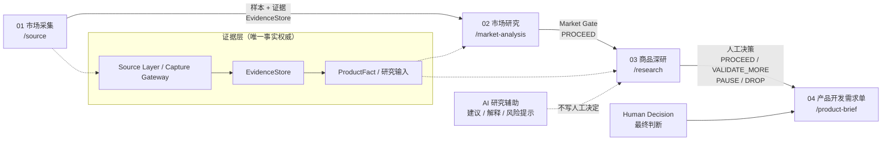

<div align="center">

# 轻选工作台 · LightChoice Workbench

**Evidence-driven Amazon Product Research & Development Workbench**

面向 Amazon 美国站的证据驱动型商品研究与产品开发决策工作台

[](https://github.com/a2578348864a-sys/lightchoice-workbench/actions/workflows/ci.yml)
[](LICENSE)


*Status: active development · local single-user workbench*

</div>

---

## 1. 这是什么

轻选工作台不是一个"AI 选品器"。它把 **市场证据 → 商品研究 → 人工判断 → 产品开发需求** 串成一条可追溯的工作流：

- **来源可追溯**：采集必须经过 Source Layer / Capture Gateway，原始观察进入 EvidenceStore；
- **结论可复核**：研究只消费已采集的证据，引用必须落在允许的证据集合内；
- **未知不编造**：缺失字段保持 unknown，不用 AI 推断补成"事实"；
- **决策可回溯**：AI 只给建议，最终由人做决定，决定与依据一起留痕。

适合需要认真做 Amazon 产品开发前期研究、又不想把判断交给黑盒工具的个人或小团队。

## 2. 核心工作流



- **01 市场采集**：从 Amazon / SellerSprite 采集样本与证据，形成可复核的商品事实。
- **02 市场研究**：样本充分性、缺口知悉、代表商品；只有 Market Gate = `PROCEED` 才允许进入 03。
- **03 商品深研**：需求、竞争、VOC 证据与研报；AI 给建议，人工在四种状态中裁决。
- **04 产品开发需求单**：只对已 `PROCEED` 且未 stale 的研究生成；支持编辑、版本历史、只读回看与批准门禁。

## 3. 产品截图

> 截图待补：需要在完全合成的演示数据环境中重新采集，不能用真实数据库、真实评论或本机 Profile 代替。
> 在补齐之前，本 README 不放置模拟或拼接图。

## 4. 核心架构

| 层 | 职责 | 关键约束 |
|---|---|---|
| Capture Gateway / Source Layer | 唯一正式采集入口；处理登录、地区、限流与来源差异 | Research 不得另开采集通道 |
| EvidenceStore | 追加式证据文件库（按主体分目录，带内容哈希与清单） | 唯一事实权威，不写临时推断 |
| Research Layer | 把证据投影为研究输入、事实与缺口 | 只消费受控证据，引用越界即失败 |
| AI Research | 生成摘要、机会、风险、改良假设 | 输出必须过 schema 与引用白名单 |
| Human Decision | 人工四态裁决与理由 | 服务端门禁，AI 不可代填 |
| Feishu Projection | 研究管理与个人看板投影 | 不是第二事实库 |

## 5. 设计原则

1. **Evidence ≠ Fact**：证据是观察，事实需要身份绑定与字段级确认。
2. **AI ≠ Human Decision**：AI 的建议不会写进人工决定字段。
3. **Estimate ≠ Confirmed**：SellerSprite 等第三方估算不会被升级成 Amazon 确认事实。
4. **Fail closed**：研报 schema 不合法、引用不在白名单、证据过期，都按失败处理并保留上一份有效结果。
5. **可回溯**：每次写操作带幂等键与版本/CAS 校验，历史决定与需求单版本可回看。

## 6. 技术栈

- Next.js 16（App Router，Node runtime）+ React 19 + TypeScript 5.7
- Prisma 5.22 + SQLite（本地文件数据库）
- Tailwind CSS 3.4 + 自有组件层
- Vitest 4（单元/合同测试）、Playwright（按需的浏览器验收）
- Node.js ≥ 20.9

## 7. 安装与运行

```bash
# 1) 安装依赖
npm ci

# 2) 配置环境变量
cp .env.example .env.local
#    至少填写 DEEPSEEK_API_KEY；DATABASE_URL 默认 file:./dev.db（位于 prisma/）

# 3) 初始化数据库（正式迁移链，不使用 db push）
npx prisma migrate deploy

# 4) 启动（本地单用户，绑定 127.0.0.1:3010）
npm run dev:local
```

生产模式：`npm run build && npm run start:local`。

健康检查：

| 端点 | 含义 |
|---|---|
| `GET /api/health` | 就绪检查：数据库只读查询 + 证据目录可读；失败返回 503 |
| `GET /api/health?probe=liveness` | 进程存活，恒 200 |

## 8. 数据与安全

- 数据库与证据都在本机：SQLite 文件 + `SOURCE_LAYER_STORE_DIR` 指向的证据目录（默认 `data/source-layer-store`）。
- 所有写操作要求 Owner 身份与同源请求；不提供公网多租户能力。
- 密钥只放 `.env.local`（已被 `.gitignore` 排除），不要提交或截图。
- 备份/恢复：`VACUUM INTO` 一致性快照 + 证据镜像 + 隔离恢复，见 [docs/ops/backup-restore.md](docs/ops/backup-restore.md)。

## 9. 当前状态与限制

**已实现**

- 01→04 主链、人工决策门禁、需求单版本与批准门禁；
- 证据权威与引用校验、写操作幂等/CAS、Owner + 同源保护；
- 本地备份与隔离恢复脚本、就绪健康检查。

**部分实现 / 有限制**

- 采集依赖真实浏览器与来源页面结构，来源改版会需要维护适配器；
- **不附带任何第三方类目数据**：仓库不含类目数据文件；`npm ci` / `npm run dev:local` / `npm run build` 会在本地生成空 schema，未导入时类目选择器显示空状态与导入指引（导入方式见 `data/amazon-taxonomy/README.md`）；
- AI 研究辅助需要自备 DeepSeek 凭据，长报告可能需要调整输出预算。

**未支持**

- 公网 SaaS、多租户、访客权限；
- 自动选品/自动立项；
- Listing 文案与生图（已从主产品退役）。

## 10. 贡献

见 [CONTRIBUTING.md](CONTRIBUTING.md) 与 [docs/development/contributing.md](docs/development/contributing.md)。
提交前请运行 `npm run lint && npm run typecheck && npm test && npm run build`。

## 许可证

代码以 [MIT License](LICENSE) 发布。第三方字体、依赖与数据来源见 [THIRD_PARTY_NOTICES.md](THIRD_PARTY_NOTICES.md)。
